# ER design for SlotRush (draft)

Two views of the same design:

1. **The relational schema** as a Mermaid `erDiagram`, one box per table, exactly as built in
   [`sql/01_schema.sql`](../sql/01_schema.sql).
2. **The conceptual EER design** written out so it can be redrawn in Chen notation in draw.io.
   Mermaid cannot draw specialisation, aggregation or attribute kinds, so these are listed here
   in full.

---

## 1. Relational schema (Mermaid)

`PK` = primary key, `FK` = foreign key, `UK` = part of a UNIQUE constraint.

```mermaid
erDiagram
    STUDENT ||--o{ STUDENT_PHONE : "has"
    STUDENT ||--o{ REGISTRATION : "makes"
    STUDENT ||--o{ WAITLIST : "joins"
    STUDENT ||--o{ COMPLETED_COURSE : "passed"
    COURSE  ||--o{ COMPLETED_COURSE : "passed in"
    COURSE  ||--o| THEORY_COURSE : "is a"
    COURSE  ||--o| LAB_COURSE : "is a"
    COURSE  ||--o| PROJECT_COURSE : "is a"
    COURSE  ||--o{ PREREQUISITE : "requires"
    COURSE  ||--o{ PREREQUISITE : "is required by"
    SLOT    ||--|{ SLOT_TIMING : "meets at"
    COURSE  ||--o{ OFFERING : "offered as"
    FACULTY ||--o{ OFFERING : "teaches"
    SLOT    ||--o{ OFFERING : "scheduled in"
    OFFERING ||--o{ REGISTRATION : "has"
    OFFERING ||--o{ WAITLIST : "has"

    STUDENT {
        varchar reg_no PK
        varchar first_name
        varchar last_name
        varchar programme
        smallint admit_year
        varchar email UK
    }
    STUDENT_PHONE {
        varchar reg_no PK, FK
        varchar phone PK
    }
    FACULTY {
        int faculty_id PK
        varchar first_name
        varchar last_name
        varchar school
        varchar email UK
    }
    COURSE {
        varchar course_code PK, UK
        varchar title
        smallint credits
        varchar course_type UK "THEORY | LAB | PROJECT"
    }
    THEORY_COURSE {
        varchar course_code PK, FK
        varchar course_type FK "always THEORY"
        smallint lecture_hours
        smallint tutorial_hours
    }
    LAB_COURSE {
        varchar course_code PK, FK
        varchar course_type FK "always LAB"
        smallint lab_hours
        varchar lab_room_type
    }
    PROJECT_COURSE {
        varchar course_code PK, FK
        varchar course_type FK "always PROJECT"
        smallint max_team_size
        varchar deliverable
    }
    PREREQUISITE {
        varchar course_code PK, FK
        varchar prereq_code PK, FK
    }
    COMPLETED_COURSE {
        varchar reg_no PK, FK
        varchar course_code PK, FK
        varchar semester
        char grade
    }
    SLOT {
        varchar slot_id PK
        varchar slot_kind "THEORY | LAB"
    }
    SLOT_TIMING {
        varchar slot_id PK, FK
        smallint day PK
        smallint period PK
    }
    OFFERING {
        int offering_id PK
        varchar course_code FK
        int faculty_id FK
        varchar slot_id FK, UK
        varchar semester UK
        varchar venue UK "NULL until allotted"
        smallint capacity
        smallint seats_left "0 to capacity"
    }
    REGISTRATION {
        int offering_id PK, FK
        varchar reg_no PK, FK
        timestamptz registered_at
    }
    WAITLIST {
        int offering_id PK, FK
        varchar reg_no PK, FK
        timestamptz queued_at
    }
    SETTINGS {
        boolean id PK "always true: one row"
        smallint min_credits
        smallint max_credits
        varchar current_semester
    }
```

`SETTINGS` stands alone: it is a one-row configuration table, not part of the ER model.

---

## 2. EER design for Chen notation

Chen notation reminders for draw.io:

| Symbol | Meaning |
|---|---|
| Rectangle | Strong entity |
| Double rectangle | Weak entity |
| Diamond | Relationship |
| Double diamond | Identifying relationship (owner to weak entity) |
| Oval | Attribute |
| Underlined name | Key attribute |
| Dashed underline | Partial key of a weak entity |
| Double oval | Multivalued attribute |
| Dashed oval | Derived attribute |
| Oval with child ovals | Composite attribute |
| Single line | Partial participation |
| Double line | Total participation |
| Circle with `d` | Disjoint specialisation |
| Box drawn around a relationship and its entities | Aggregation |

### 2.1 Entities and their attributes

**STUDENT** (strong)
- `reg_no`: key attribute (underlined)
- `name`: **composite** attribute with components `first_name` and `last_name`
- `programme`, `admit_year`: simple
- `email`: simple, unique (a second candidate key; not underlined in Chen)
- `phone`: **multivalued** (double oval). Stored as table `student_phone`
- `total_credits`: **derived** (dashed oval). Computed from the courses the student is registered for,
  in view `v_student_credits`, never stored

**FACULTY** (strong)
- `faculty_id`: key
- `name`: composite (`first_name`, `last_name`)
- `school`, `email`: simple

**COURSE** (strong, superclass)
- `course_code`: key
- `title`, `credits`: simple
- `course_type`: the defining attribute of the specialisation (see 2.3)

**THEORY_COURSE**, **LAB_COURSE**, **PROJECT_COURSE** (subclasses of COURSE, see 2.3)
- THEORY_COURSE: `lecture_hours`, `tutorial_hours`
- LAB_COURSE: `lab_hours`, `lab_room_type`
- PROJECT_COURSE: `max_team_size`, `deliverable`
- Each inherits `course_code`, `title`, `credits` from COURSE.

**SLOT** (strong)
- `slot_id`: key
- `slot_kind`: simple (THEORY or LAB)

**SLOT_TIMING** (**weak** entity, double rectangle)
- `day`, `period`: together the **partial key** (dashed underline)
- Owner: SLOT, through the identifying relationship MEETS_AT
- Full identifier: (`slot_id`, `day`, `period`)

### 2.2 Relationships

| Relationship | Entities | Cardinality | Participation | Attributes |
|---|---|---|---|---|
| MEETS_AT (identifying, double diamond) | SLOT : SLOT_TIMING | 1 : N | SLOT total (every slot meets at least once); SLOT_TIMING total (cannot exist without its slot) | none |
| REQUIRES (recursive) | COURSE (role *course*) : COURSE (role *prerequisite*) | M : N | partial on both sides | none |
| PASSED | STUDENT : COURSE | M : N | partial on both sides | `semester`, `grade` |
| TEACHES (ternary) | FACULTY, COURSE, SLOT | each (faculty, course, slot) combination at most once per semester and venue | partial for all three | `semester`, `venue`, `capacity`, `seats_left` (see 2.4) |
| REGISTERS | STUDENT : OFFERING aggregate | M : N | partial on both sides | `registered_at` |
| WAITLISTED_FOR | STUDENT : OFFERING aggregate | M : N | partial on both sides | `queued_at` |

Label the two lines of REQUIRES with their role names (*course* and *prerequisite*); that is how
Chen notation shows a recursive relationship.

### 2.3 Specialisation of COURSE

- Superclass: COURSE. Subclasses: THEORY_COURSE, LAB_COURSE, PROJECT_COURSE.
- **Disjoint** (circle with `d`): a course is exactly one of the three.
- **Total** (double line from COURSE to the circle): every course belongs to one subclass.
- **Attribute-defined** on `course_type`: write `course_type` beside the line into the circle.

How the relational schema enforces it:

- *Disjointness.* `course.course_type` holds one value only. Each subtype table has its own
  `course_type` column fixed by a CHECK (for example `CHECK (course_type = 'LAB')`) and a composite
  foreign key `(course_code, course_type)` that references `course (course_code, course_type)`.
  A LAB course's parent row is `(code, 'LAB')`, so a `theory_course` row for it would need
  `(code, 'THEORY')` in `course`, which cannot exist. The course therefore appears in at most one
  subtype table. The UNIQUE constraint on `course (course_code, course_type)` exists only so that
  the composite key can be referenced.
- *Totality.* A foreign key can stop a child row existing without its parent, but it cannot force
  a parent to have a child. If course and subtype referenced each other, neither row could be
  inserted first. So totality is enforced by **deferred constraint triggers**
  (`DEFERRABLE INITIALLY DEFERRED`): when a course row is inserted or updated, or a subtype row is
  deleted, the check runs at COMMIT and raises an error if the course has no row in the subtype
  table its `course_type` names. Inside one transaction the course row and its subtype row can
  arrive in either order; by COMMIT both must be there. Tests:
  `test_total_course_without_subtype_row_fails_at_commit`,
  `test_total_deleting_subtype_row_fails_at_commit`.
- *Changing type.* `course_type` cannot be changed while the subtype row exists (the composite
  foreign key blocks it). A type change means deleting the old subtype row, updating the course
  and inserting the new subtype row in one transaction.

### 2.4 Aggregation: OFFERING

TEACHES is a ternary relationship between FACULTY, COURSE and SLOT. Students do not register for
a faculty member, a course or a slot separately; they register for one particular
"faculty teaches course in slot" combination. In Chen notation:

1. Draw the TEACHES diamond connected to FACULTY, COURSE and SLOT.
2. Draw a box around TEACHES and its three entities and name it **OFFERING**.
3. Draw the REGISTERS diamond between STUDENT and the OFFERING box (not any one entity inside it).
   Do the same for WAITLISTED_FOR.
4. Attach TEACHES' attributes `semester`, `venue`, `capacity` and `seats_left` to the TEACHES diamond.

In the relational schema the aggregate becomes table `offering` with a surrogate key
`offering_id`. Its constraints:
- `CHECK (seats_left BETWEEN 0 AND capacity)`
- `UNIQUE (venue, semester, slot_id)`: no room is double-booked. `venue` is NULL until a room is
  allotted, and UNIQUE treats NULLs as distinct, so any number of unallotted classes may share a slot.
- A trigger keeps lab courses in lab slots and theory and project courses in theory slots.

### 2.5 Constraints not visible in the diagram

| Constraint | Where |
|---|---|
| Student does not take the same course twice in a semester | `register()` rule 2, `check-data` |
| No two of a student's slots share a (day, period) | `register()` rule 3, `check-data` |
| Prerequisites completed | `register()` rule 4 |
| Credits do not exceed `settings.max_credits` | `register()` rule 5 |
| Faculty not in two overlapping slots | data generator, `check-data` |
| `seats_left` = capacity minus registrations | `register()`, `drop_course()`, `swap_course()`, `check-data`, crash demo check (b) |
