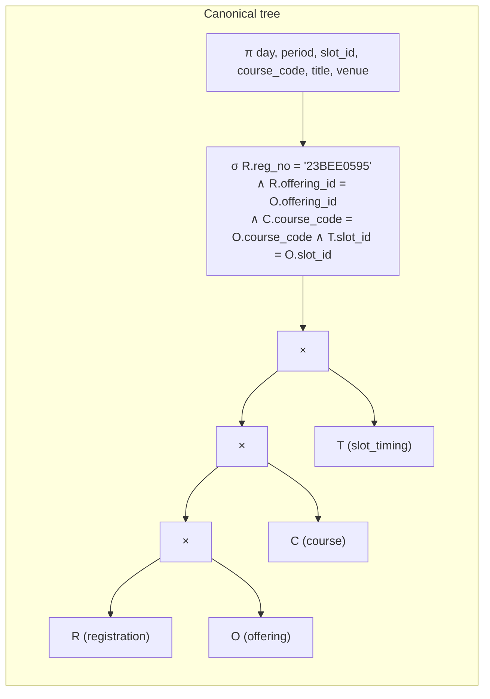
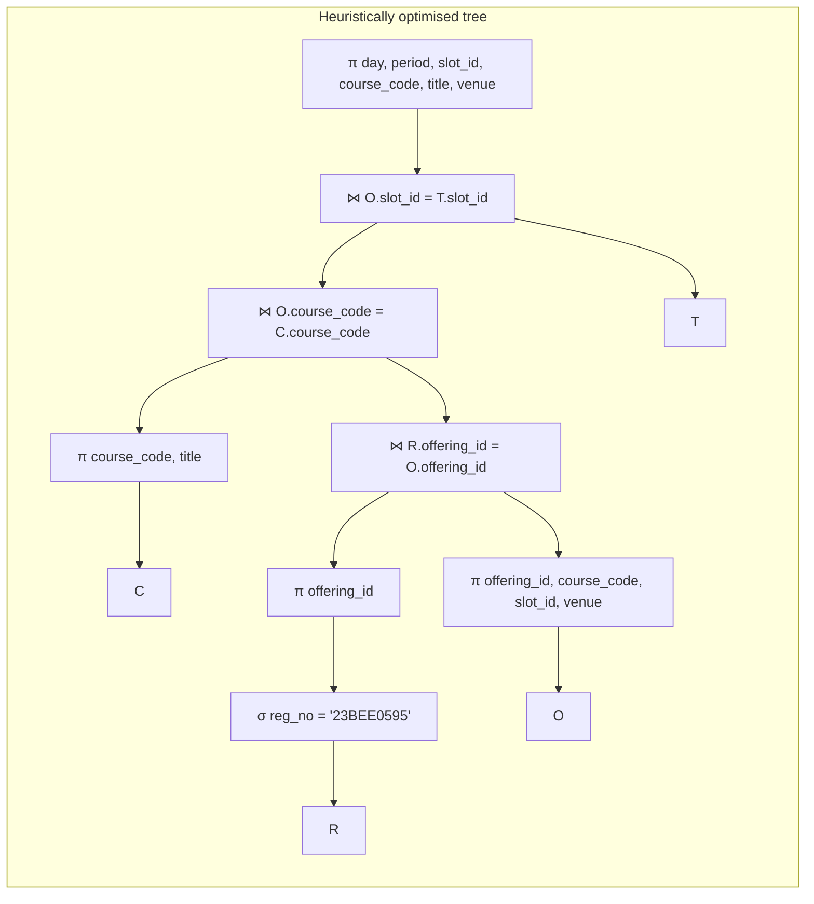
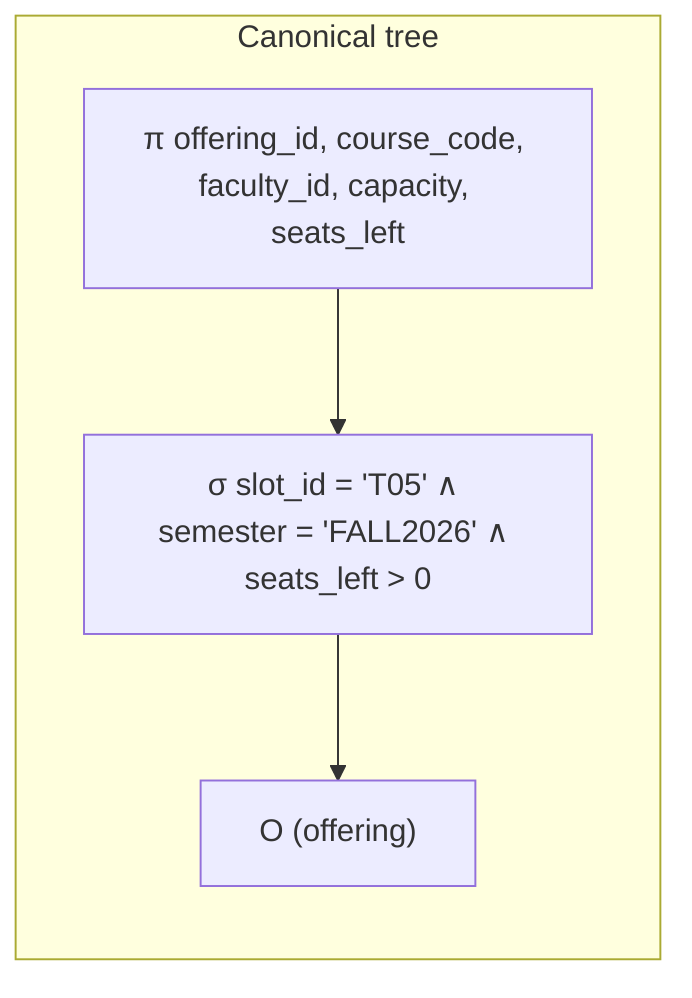
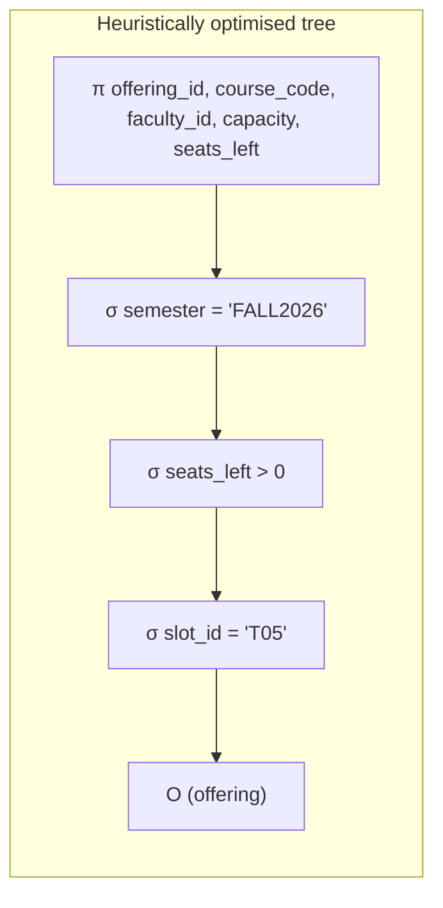
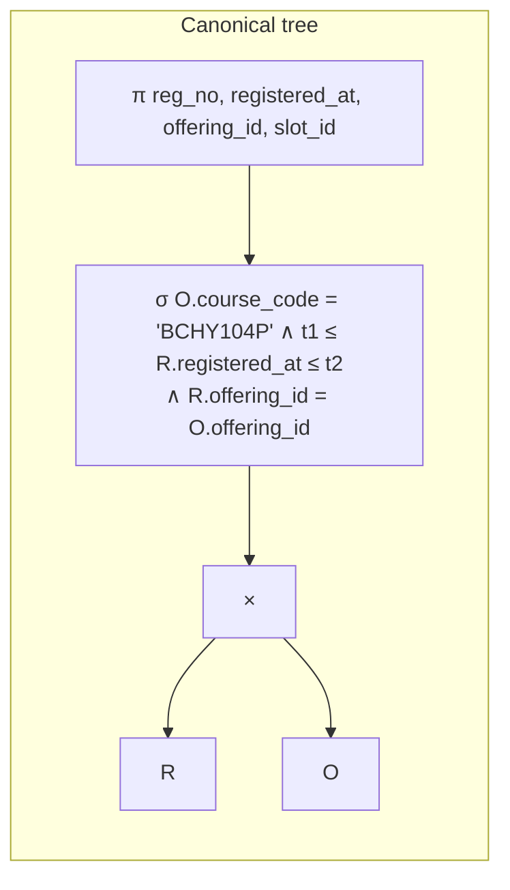
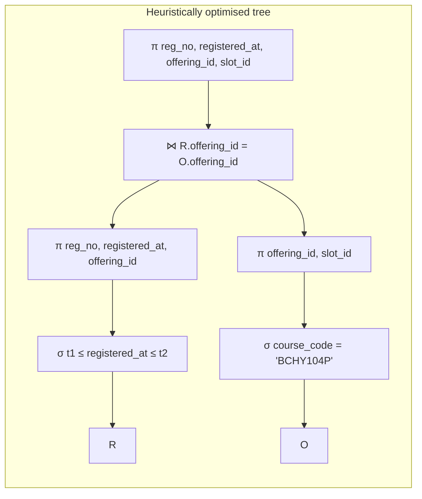
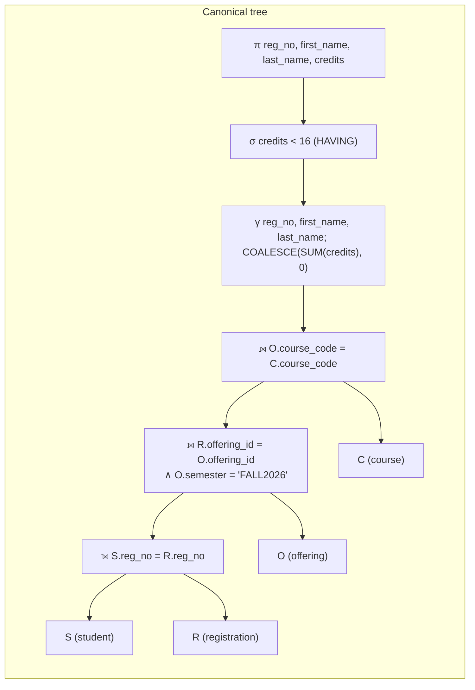
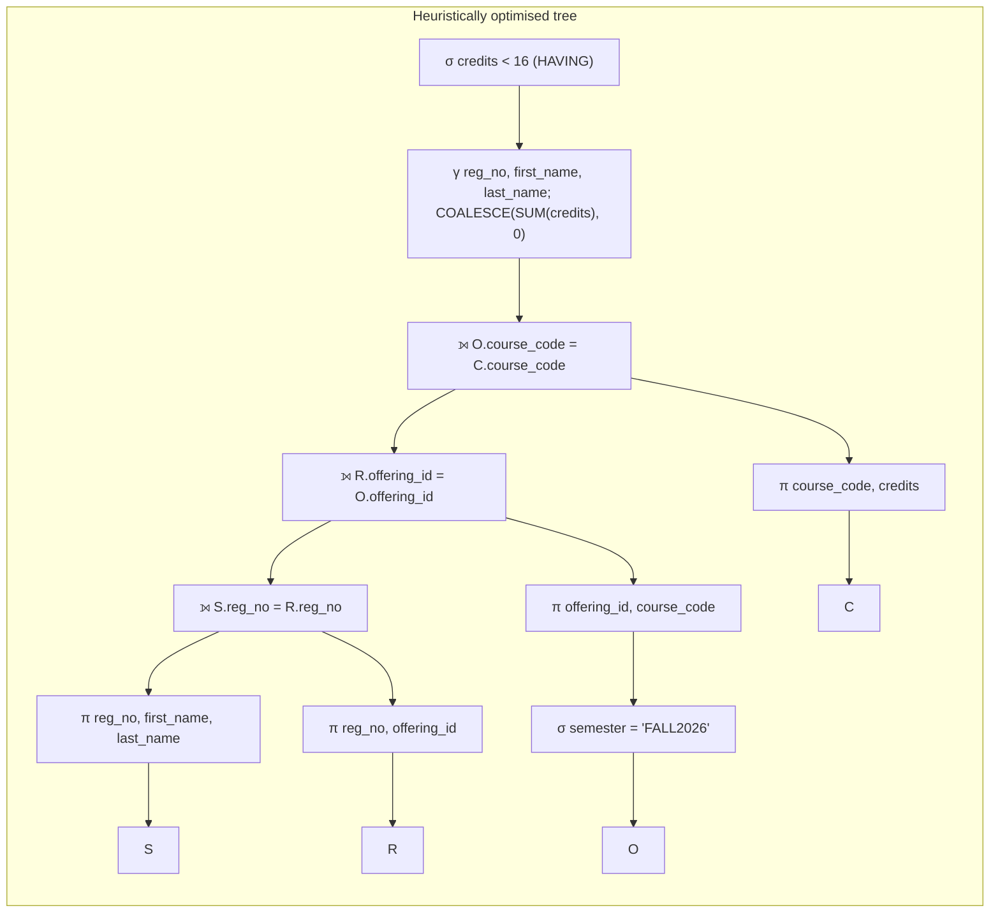
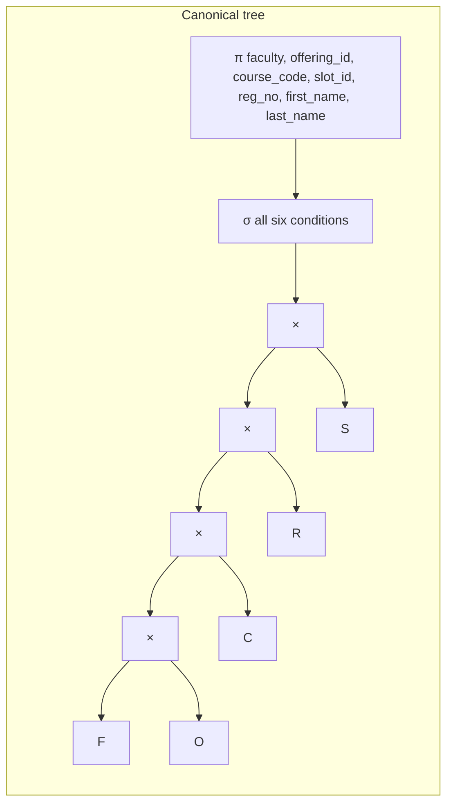
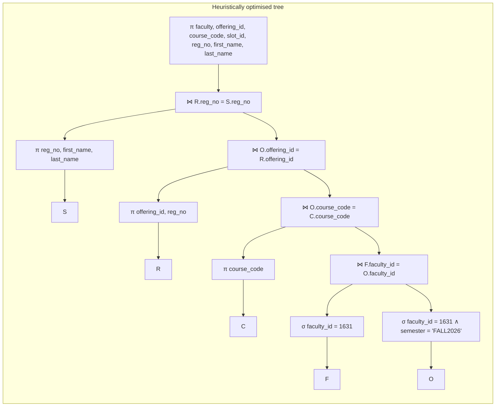

# Query processing and indexing (draft)

Evidence: `python -m slotrush bench` writes
- `results/plans/<query>__<setup>.txt`: `EXPLAIN (ANALYZE, BUFFERS)` for every query and setup
- `results/bench_timings.csv`: every measured run; `results/bench_summary.csv`: medians and access paths
- `results/bench_chart.png`: the bar chart (log scale)

Setups: **none** (only the B-tree indexes that primary keys and UNIQUE constraints create),
**btree** (plus five B-tree secondary indexes) and **hash** (the same five as hash indexes).
Timing is PostgreSQL's own `Execution Time` (no network), one warm-up run then the median of
seven, with JIT compilation switched off for the session.

**Compare setups within one run, not absolute times across runs.** On this laptop two runs an hour
apart gave the same plans and the same ratios, but every time in the second run was about 4–5×
higher (for example Q1 without an index: 13.7 ms, then 58.6 ms). All pages were already in
PostgreSQL's buffer cache both times ("shared hit" only), so the difference is CPU speed inside the
Docker VM, not the database. The table below is the run whose files are in `results/`.

## Notation

| Symbol | Meaning |
|---|---|
| σ<sub>c</sub>(R) | selection: rows of R satisfying c |
| π<sub>a,b</sub>(R) | projection onto attributes a, b |
| R × S | Cartesian product |
| R ⋈<sub>c</sub> S | join on condition c |
| R ⟕<sub>c</sub> S | left outer join |
| γ<sub>g; f(x)→y</sub>(R) | grouping on g with aggregate f |
| τ<sub>a</sub>(R) | sort on a (ORDER BY) |

Relation names: R = registration, O = offering, C = course, T = slot_timing, S = student,
F = faculty.

**Canonical tree.** The textbook translation of a SELECT block: the Cartesian product of the FROM
list, one σ holding the whole WHERE clause (join conditions included), one π for the SELECT list.

**Heuristic optimisation.** (1) Break the σ into its conjuncts. (2) Push each selection down to
the relation it mentions. (3) Turn σ-over-× into joins. (4) Join the most selective (smallest)
inputs first. (5) Push projections down so only needed columns travel up the tree.

## Constraint indexes that exist in every setup

```
course        btree (course_code, course_type)   -- UNIQUE, target of the subtype FKs
course        btree (course_code)                -- PK
faculty       btree (email), btree (faculty_id)
offering      btree (offering_id)                -- PK
offering      btree (venue, semester, slot_id)   -- UNIQUE
registration  btree (offering_id, reg_no)        -- PK
slot_timing   btree (slot_id, day, period)       -- PK
student       btree (email), btree (reg_no)
```

A B-tree on (a, b) helps a predicate on a, or on a and b, but not one on b alone (PostgreSQL 17
has no skip scan; that is why the project pins version 17). None of the five predicates below is
the leading column of one of these indexes.

## Results

| Query | none | B-tree | hash | What decides it |
|---|---:|---:|---:|---|
| Q1 student timetable | 12.4 ms | 0.19 ms | 0.17 ms | equality on `registration.reg_no`: any index avoids reading 258,514 rows (~64× faster) |
| Q2 seats in a slot | 0.37 ms | 0.12 ms | 0.08 ms | equality on `offering.slot_id`; the table is small (4,500 rows) |
| Q3 course + time range | 9.96 ms | 0.83 ms | 10.0 ms | the **range** on `registered_at`: only the B-tree can serve it (~12× faster); hash = no index |
| Q4 below min credits | 157 ms | 176 ms | 152 ms | no selective predicate: every row is read in every setup |
| Q5 faculty class list | 2.56 ms | 2.66 ms | 2.29 ms | the index only replaces a scan of 4,500 offerings; the rest uses PKs |

---

## Q1. One student's timetable

```sql
SELECT t.day, t.period, o.slot_id, c.course_code, c.title, o.venue
FROM registration r
JOIN offering o    ON o.offering_id = r.offering_id
JOIN course c      ON c.course_code = o.course_code
JOIN slot_timing t ON t.slot_id = o.slot_id
WHERE r.reg_no = '23BEE0595'
ORDER BY t.day, t.period;
```

**Relational algebra (canonical)**

τ<sub>day, period</sub> π<sub>day, period, slot_id, course_code, title, venue</sub>
σ<sub>R.reg_no='23BEE0595' ∧ R.offering_id=O.offering_id ∧ C.course_code=O.course_code ∧ T.slot_id=O.slot_id</sub>
(R × O × C × T)

**Optimised**

τ<sub>day, period</sub> π<sub>…</sub>
( ( ( π<sub>offering_id</sub>(σ<sub>reg_no='23BEE0595'</sub>(R)) ⋈ π<sub>offering_id, course_code, slot_id, venue</sub>(O) )
⋈ π<sub>course_code, title</sub>(C) ) ⋈ T )





**What PostgreSQL did** (`results/plans/Q1_student_timetable__btree.txt`): exactly the optimised
order. Bitmap Index Scan on `ix_registration_reg_no` finds the student's 20 rows, then three
nested-loop joins probe `offering_pkey`, the course key and `slot_timing_pkey` (an index-only
scan: every needed column is in the index), then a Sort. Without the secondary index
(`__none.txt`) the plan is the same except the first step becomes a Seq Scan of all 258,514
registration rows, which is the whole difference between 12.4 ms and 0.19 ms. The hash index
serves the equality just as well as the B-tree.

## Q2. Seats left in one slot

```sql
SELECT o.offering_id, o.course_code, o.faculty_id, o.capacity, o.seats_left
FROM offering o
WHERE o.slot_id = 'T05' AND o.semester = 'FALL2026' AND o.seats_left > 0
ORDER BY o.seats_left DESC;
```

**Relational algebra (canonical)**

τ<sub>seats_left DESC</sub> π<sub>offering_id, course_code, faculty_id, capacity, seats_left</sub>
σ<sub>slot_id='T05' ∧ semester='FALL2026' ∧ seats_left>0</sub>(O)

**Optimised.** With one table there is no × to turn into a join, nothing to push below a join,
and the π already sits directly above the selections. One heuristic still changes the tree:
step (1) splits the σ into a cascade of three. σ is commutative, so every order of the cascade
gives the same rows; the heuristic puts the most selective condition first, closest to the table,
so each later test sees as few rows as possible:

τ<sub>seats_left DESC</sub> π<sub>…</sub>
σ<sub>semester='FALL2026'</sub>( σ<sub>seats_left>0</sub>( σ<sub>slot_id='T05'</sub>(O) ) )

| Condition | Offerings it keeps on its own |
|---|---:|
| `slot_id = 'T05'` | 159 of 4,500 (3.5%) |
| `seats_left > 0` | 2,953 of 4,500 (66%) |
| `semester = 'FALL2026'` | 4,500 of 4,500 (all: the only other semester is `DEMO`, used by the demos) |

Applied in that order, the rows go 4,500 → 159 → 115 → 115.





**What PostgreSQL did.**
- *none*: a Seq Scan tests all three conditions on every row, as in the canonical tree: 4,385 of
  the 4,500 rows removed, 83 pages read.
- *btree* and *hash*: the optimised order. A Bitmap Index Scan on `ix_offering_slot_id` applies
  `slot_id = 'T05'` first and finds the 159 offerings; the Bitmap Heap Scan then applies the other
  two conditions as one filter (44 removed, 115 left), reading 37–38 pages.

The gain is small in absolute terms (0.37 → 0.12 ms) because the whole table is only 83 pages.

## Q3. Registrations for a course within a time range

```sql
SELECT r.reg_no, r.registered_at, o.offering_id, o.slot_id
FROM registration r
JOIN offering o ON o.offering_id = r.offering_id
WHERE o.course_code = 'BCHY104P'
  AND r.registered_at BETWEEN '2026-07-06 21:00+05:30' AND '2026-07-06 21:30+05:30'
ORDER BY r.registered_at;
```

**Relational algebra (canonical)**

τ<sub>registered_at</sub> π<sub>reg_no, registered_at, offering_id, slot_id</sub>
σ<sub>O.course_code='BCHY104P' ∧ R.registered_at ≥ t1 ∧ R.registered_at ≤ t2 ∧ R.offering_id=O.offering_id</sub>(R × O)

**Optimised**

τ<sub>registered_at</sub> π<sub>…</sub>( π<sub>reg_no, registered_at, offering_id</sub>(σ<sub>t1 ≤ registered_at ≤ t2</sub>(R))
⋈<sub>offering_id</sub> π<sub>offering_id, slot_id</sub>(σ<sub>course_code='BCHY104P'</sub>(O)) )





**What PostgreSQL did.**
- *none*: Parallel Seq Scan of registration with the time filter (2,730 rows survive, 255,784
  removed), Seq Scan of offering for the course (63 rows), Hash Join, Sort. Both selections are
  pushed down as in the optimised tree, but each costs a full scan.
- *btree*: Index Scan on `ix_registration_registered_at` reads only the 2,730 rows in the window,
  Bitmap Index Scan on `ix_offering_course_code` finds the 63 offerings, Hash Join. 9.96 → 0.83 ms.
- *hash*: the course predicate uses the hash index, but registration is back to a **Seq Scan**: a
  hash index stores hash values in no particular order, so it can only answer `=`, never
  `BETWEEN`. The hash index on `registered_at` exists in this setup and is ignored.

The planner did not use the registration PK `(offering_id, reg_no)` for the join here: with 63
offerings it judged one hash join cheaper than 63 index probes.

## Q4. Students below the minimum credits

```sql
SELECT s.reg_no, s.first_name, s.last_name, COALESCE(SUM(c.credits), 0) AS credits
FROM student s
LEFT JOIN registration r ON r.reg_no = s.reg_no
LEFT JOIN offering o     ON o.offering_id = r.offering_id AND o.semester = 'FALL2026'
LEFT JOIN course c       ON c.course_code = o.course_code
GROUP BY s.reg_no, s.first_name, s.last_name
HAVING COALESCE(SUM(c.credits), 0) < 16;
```

**Relational algebra (canonical)**

π<sub>reg_no, first_name, last_name, credits</sub> σ<sub>credits < 16</sub>
γ<sub>reg_no, first_name, last_name; COALESCE(SUM(credits),0)→credits</sub>
( ( (S ⟕<sub>S.reg_no=R.reg_no</sub> R) ⟕<sub>R.offering_id=O.offering_id ∧ O.semester='FALL2026'</sub> O )
⟕<sub>O.course_code=C.course_code</sub> C )

The σ after γ is the HAVING clause. The usual canonical recipe (× of the FROM list, then one σ)
does not work for outer joins: a σ over a × is an inner join, which would drop every student with
no matching row, and those are exactly the students with 0 credits. So the canonical tree keeps
the three ⟕ as written, each with its whole ON condition, nothing pushed down, and the π for the
SELECT list on top.

**Optimised.** The heuristics barely apply: there is no selective condition to push down, so no
smaller input to join first. The one legal push-down is the semester test, which belongs to the
null-supplying side O of an outer join, so it may be applied to O before joining
(σ<sub>semester='FALL2026'</sub>(O)). It may NOT be moved above the outer join into a WHERE: that
would throw away students with no registrations, who are exactly the ones with 0 credits.
Projections go down to the four tables, and the top π disappears: γ already outputs exactly the
SELECT list, so it would keep every column.

σ<sub>credits < 16</sub> γ<sub>…</sub>
( ( ( π<sub>reg_no, first_name, last_name</sub>(S) ⟕<sub>reg_no</sub> π<sub>reg_no, offering_id</sub>(R) )
⟕<sub>offering_id</sub> π<sub>offering_id, course_code</sub>(σ<sub>semester='FALL2026'</sub>(O)) )
⟕<sub>course_code</sub> π<sub>course_code, credits</sub>(C) )





**What PostgreSQL did** (all setups the same): Seq Scans of all four tables, a Hash Right Join
(it builds the hash table on the 30,000 students and streams the 258,514 registrations past it;
"right" because the preserved side is the hashed one), two Hash Left Joins, then HashAggregate
with the HAVING filter: 7,693 students returned. The indexes cannot help a query that must read
every row; the differences between setups (152–176 ms) are noise.

## Q5. A faculty member's class list

```sql
SELECT f.last_name AS faculty, o.offering_id, c.course_code, o.slot_id,
       s.reg_no, s.first_name, s.last_name
FROM faculty f
JOIN offering o     ON o.faculty_id = f.faculty_id
JOIN course c       ON c.course_code = o.course_code
JOIN registration r ON r.offering_id = o.offering_id
JOIN student s      ON s.reg_no = r.reg_no
WHERE f.faculty_id = 1631 AND o.semester = 'FALL2026'
ORDER BY o.offering_id, s.last_name;
```

**Relational algebra (canonical)**

τ π<sub>F.last_name, offering_id, course_code, slot_id, reg_no, S.first_name, S.last_name</sub>
σ<sub>F.faculty_id=1631 ∧ O.semester='FALL2026' ∧ O.faculty_id=F.faculty_id ∧ C.course_code=O.course_code ∧ R.offering_id=O.offering_id ∧ S.reg_no=R.reg_no</sub>
(F × O × C × R × S)

**Optimised.** Push F.faculty_id = 1631 to F; because O.faculty_id = F.faculty_id, the same
constant also applies to O (transitivity), so σ<sub>faculty_id=1631 ∧ semester='FALL2026'</sub>(O)
is pushed to O as well. Join the two tiny inputs first, then grow outward:

( ( ( σ<sub>faculty_id=1631</sub>(F) ⋈ σ<sub>faculty_id=1631 ∧ semester='FALL2026'</sub>(O) ) ⋈ C ) ⋈ R ) ⋈ S





**What PostgreSQL did** (`Q5_faculty_class_list__btree.txt`): the optimised order exactly:
`faculty_pkey` (1 row) → `ix_offering_faculty_id` (8 offerings) → course key (index-only) →
`registration_pkey` (index-only, 558 rows; this is where the PK ordered by offering_id pays
off) → `student_pkey` (558 probes) → Sort. Note the index condition on offering is
`faculty_id = 1631`: the planner derived it from the join condition, as in the heuristic. Without
the secondary index the only change is a Seq Scan of offering (4,500 rows), a small part of the
total; most of the time is the 558 student lookups, which use the PK in every setup. The three
setups are within run-to-run noise of each other (2.3–2.7 ms).

---

## Tuple relational calculus

**Q2** (seats left in slot T05):

{ o.offering_id, o.course_code, o.capacity, o.seats_left | o ∈ Offering ∧ o.slot_id = 'T05' ∧
o.semester = 'FALL2026' ∧ o.seats_left > 0 }

**Q1** (timetable of student 23BEE0595):

{ t.day, t.period, c.course_code, c.title | t ∈ SlotTiming ∧ c ∈ Course ∧
∃r ∈ Registration ∃o ∈ Offering ( r.reg_no = '23BEE0595' ∧ r.offering_id = o.offering_id ∧
o.course_code = c.course_code ∧ o.slot_id = t.slot_id ) }

**Q5** (students of faculty 1631):

{ s.reg_no, s.first_name, s.last_name | s ∈ Student ∧ ∃r ∈ Registration ∃o ∈ Offering
( r.reg_no = s.reg_no ∧ r.offering_id = o.offering_id ∧ o.faculty_id = 1631 ∧
o.semester = 'FALL2026' ) }

Q4 needs SUM, which plain tuple relational calculus does not have. Its extreme case, students
with **no** registration this semester, can be written with ¬∃:

{ s.reg_no | s ∈ Student ∧ ¬∃r ∈ Registration ∃o ∈ Offering ( r.reg_no = s.reg_no ∧
r.offering_id = o.offering_id ∧ o.semester = 'FALL2026' ) }
